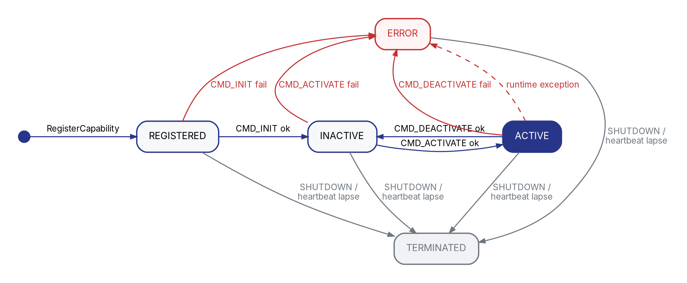

---
last_update:
  date: 2026-10-14
---

# 理解软件包、能力与生命周期

本页解释实现软件包时必须理解的运行时约定。可先完成[第一个软件包](package-start.md)，再根据需要查询身份、能力寻址和生命周期。

## Robonix 是什么

Robonix 为具身智能模型提供统一的运行时。硬件驱动以原语暴露设备能力；建图、导航、语音等算法以服务暴露可复用功能；技能封装具有任务语义的行为。Atlas 维护能力目录，Pilot 把用户意图转换为执行方案，Executor 调用方案中的能力。

系统组件分两层，判据是能不能换掉。<strong>核心系统组件</strong>不可更换，只被上层依赖，启动不依赖任何系统级服务，包括 Atlas、Chronos、Keystone、Nexus、Scribe 和 Vitals。Vitals 运行时会消费 Soma 的健康流，但那是后台重试的数据订阅，Soma 不在时它照常启动并提供服务，只是健康数据降级。<strong>系统级服务</strong>可以替换，彼此之间存在依赖，包括 Executor、Liaison、Pilot、Scene、Sentinel 和 Soma。系统级服务与你要开发的导航、建图等服务处于同一层级，只是由 Robonix 自带。

这 12 个名字里有 4 个目前没有运行时实现：Chronos、Keystone 和 Sentinel 只有设计说明，Nexus 是通信库的统称而非独立进程。开发软件包时不能依赖它们，也不能写进部署清单。各组件的实现状态见[系统组件](../architecture/components.md)。

开发软件包时会遇到以下系统组件：

| 组件 | 层 | 作用 | 软件包开发者何时需要配置 |
|---|---|---|---|
| Atlas | 核心 | 保存能力约定、提供方、能力和连接信息 | 每个软件包都要连接；通常只配置地址 |
| Vitals | 核心 | 汇总组件与设备健康状态 | 提供健康能力或接入健康仪表盘时 |
| Executor | 系统级服务 | 执行 Pilot 生成的机器人任务描述语言（RTDL）方案 | 技能或长任务需要验证执行、状态与取消时 |
| Liaison | 系统级服务 | 承接客户端、文本和语音交互 | 接入外部客户端或语音链路时 |
| Pilot | 系统级服务 | 把用户意图规划为 RTDL | 需要让模型发现和调用能力时 |
| Scene | 系统级服务 | 维护环境对象、区域和空间关系 | 技能需要查询环境或语义目标时 |
| Soma | 系统级服务 | 保存本体结构和部件状态，管理原语与技能 | 接入新机器人、硬件部件或本体状态时 |

运行时围绕以下对象组织：

| 对象 | 作用 | 示例 |
|---|---|---|
| 软件包 | 描述一份可构建、可启动的交付物 | `primitive-realsense-camera-rbnx` |
| 能力约定（Contract） | 稳定、可复用的接口描述，包含数据类型、交互模式、版本和类别 | `robonix/primitive/camera/rgb` |
| 能力（Capability） | 运行中提供方针对某条能力约定声明的实现与传输绑定 | `front_camera` + `robonix/primitive/camera/rgb` + `ros2` |
| 能力提供方（CapabilityProvider） | 软件包启动后注册到 Atlas 的运行实例 | `front_camera` |

能力约定可以在没有提供方运行时由 Atlas 从 TOML 和 IDL 加载。能力只在提供方注册并声明后存在，记录 `provider_id`、`contract_id`、传输及传输参数；调用方连接后再从通道取得端点。

能力目录属于控制面。真实图像、点云、RPC 请求或工具调用通过 ROS 2、gRPC 或 MCP 直接传输，不经过 Atlas 转发。

当前由 Pilot 规划、Executor 代表模型调用的业务能力使用 MCP 传输。gRPC 和 ROS 2 服务适合确定性客户端或组件间调用；能力约定中的 `rpc` 只表示请求—响应语义，不指定某一种通信库。

## 原语、服务与技能

### 原语、服务与技能的职责

| 类型 | 责任 | 典型内容 |
|---|---|---|
| 原语 | 把设备和硬件状态转换为标准接口 | 底盘、机械臂、相机、雷达、音频、设备健康 |
| 服务 | 组合数据或算法，提供场景级功能 | 建图、定位、导航、语音、记忆 |
| 技能 | 暴露可由 Pilot 选择的任务级行为 | 探索、抓取、问候 |

Python 中分别使用 `Primitive`、`Service` 和 `Skill`。三者共享能力声明、生命周期和连接接口；区别主要体现在向 Atlas 注册的类型，以及 Executor 对技能的延迟激活策略。

原语命名空间不是封闭枚举。Robonix 当前提供机械臂、音频、相机、底盘、灵巧手、设备健康、IMU、激光雷达、四足姿态和机器人描述十类标准能力约定；新硬件类型可以提交新的标准约定。

### 运行时身份

部署清单中实例的 `name` 覆盖代码创建运行实例时的 `id`：

```python
camera = Primitive(
    id="front_camera",
    namespace="robonix/primitive/camera",
)
```

```yaml
primitive:
  - name: front_camera
    url: https://github.com/example/primitive-camera-rbnx
```

同一机器人可以启动多个实现相同接口的设备，例如 `front_camera` 和 `arm_camera`。调用方按 `provider_id` 选择实例，不需要为每台相机发明不同的能力约定 ID。

### 能力寻址

同一能力提供方可以用不同传输实现同一能力约定，并为每种传输分别声明一项能力。因此运行时能力键包含：

```text
(provider_id, contract_id, transport)
```

Atlas 查询返回能力元数据。调用 `connect_capability(...)` 后得到的通道（Channel）才包含本次连接应使用的端点。

### 能力目录（Atlas）

Atlas 二进制未配置时绑定 `0.0.0.0:50051`；`rbnx init` 生成的部署清单会显式设置 `127.0.0.1:50051`。服务端监听地址可由部署中的 `system.atlas.listen` 或 `ROBONIX_ATLAS_LISTEN` 修改，能力提供方和 `rbnx` 等客户端则用 `ROBONIX_ATLAS` 选择连接端点。能力提供方启动后先注册自身，再声明能力；消费者可通过 `ATLAS.find_capability(...)` 搜索并建立连接。详细流程见 [Atlas 能力目录](../architecture/atlas.md)。

## 能力约定

### 描述文件与 IDL

能力约定由 TOML 描述文件和 ROS 接口定义语言（Interface Definition Language，IDL）共同组成：

```toml
[contract]
id = "robonix/service/example/hello"
version = "1"
kind = "service"
idl = "hello/srv/Hello.srv"

[mode]
type = "rpc"
```

```text title="capabilities/lib/hello/srv/Hello.srv"
string name
---
string message
```

`kind` 是能力约定元数据，不决定提供方在 Atlas 中注册成原语、服务还是技能；提供方类型由 `Primitive`、`Service` 或 `Skill` 决定。

### 模式与传输

模式（mode）描述接口语义和数据流方向；传输（transport）描述运行时通信技术。

| 模式 | 语义 | 常见传输 |
|---|---|---|
| `rpc` | 一次请求、一次响应 | gRPC、MCP、ROS 2 service |
| `rpc_server_stream` | 一次请求、连续响应 | gRPC |
| `rpc_client_stream` | 连续请求、一次响应 | gRPC |
| `rpc_bidirectional_stream` | 双向连续消息 | gRPC |
| `topic_out` | 提供方持续发布 | ROS 2 话题 |
| `topic_in` | 提供方持续接收 | ROS 2 话题 |

方向始终以声明该能力的提供方为基准：`topic_out` 表示提供方输出，`topic_in` 表示提供方接收。它不描述调用方变量名，也不等同于某个固定 ROS 2 话题。

| 模式 | gRPC | ROS 2 | MCP |
|---|:---:|:---:|:---:|
| `rpc` | 支持 | 通过 service 支持 | 支持 |
| `rpc_server_stream` | 支持 | 不支持 | 不支持 |
| `rpc_client_stream` | 支持 | 不支持 | 不支持 |
| `rpc_bidirectional_stream` | 支持 | 不支持 | 不支持 |
| `topic_out` / `topic_in` | 以 gRPC stream 映射 | 支持 | 不支持 |

`rpc` 不等于 gRPC，也不要求使用 gRPC 装饰器。它只说明“一次请求、一次响应”。选择 gRPC 时使用 `@provider.grpc(...)`，选择 MCP 时使用 `@provider.mcp(...)`。选择 ROS 2 service 时由 `rclpy` 创建服务，再用 `provider.declare_ros2_service(...)` 向 Atlas 声明端点。提供方应根据现有实现、调用方和部署拓扑选择传输。

`rpc` 的一次响应也不表示业务动作必须已经结束。通过 MCP 启动导航、抓取等长时间任务时，提供方可以同时注册主能力及其 `/status` 和 `/cancel` 子能力。Executor 据此持续查询状态并响应方案取消。该约定见 [MCP 与 gRPC](python-api.md#mcp-与-grpc)。

模型需要发现并离散调用的工具通常使用 MCP；确定性的进程间控制、生命周期和流式请求通常使用 gRPC；机器人内部已有的高频传感与控制图通常保留 ROS 2。能力约定只定义语义，不会替开发者自动选择传输。提供方声明的传输、Atlas 返回的端点和消费者建立的客户端必须一致。

当前 Python 运行时不会在装饰器注册阶段完整校验“模式—传输”矩阵。生成类型、提供方和消费者是否选了同一传输，要靠端到端测试确认。

### 全局与软件包内能力约定

标准能力约定位于 Robonix 源码的 `capabilities/`。只有软件包独有、尚未成为标准接口的能力约定才放到自身 `capabilities/`。`rbnx codegen` 和 `rbnx boot` 会合并全局约定与部署中软件包的局部约定。高级目录替换和同 ID 覆盖规则见 [Atlas 能力目录](../architecture/atlas.md)。

## 生命周期

### 状态

原语、服务与技能的运行实例使用以下状态。图中的蓝色路径是正常生命周期，红色路径表示命令失败或运行时异常，灰色路径表示关闭或心跳超时：



该图突出正常启动、运行、停用和退出路径，不穷举 Atlas 接受的全部状态上报。当前 Atlas 还允许 `ERROR → INACTIVE`，用于实例修正故障后重新初始化；任何状态都可以进入 `ERROR` 或 `TERMINATED`，重复上报相同状态按幂等操作接受。

| 状态 | 含义 |
|---|---|
| `REGISTERED` | 已向 Atlas 注册，但尚未完成初始化 |
| `INACTIVE` | 配置已解析，尚未占用热运行资源 |
| `ACTIVE` | 可以处理业务请求或数据流 |
| `ERROR` | 初始化或运行失败 |
| `TERMINATED` | 正在退出或已经退出 |

### 生命周期接口与处理函数

生命周期接口（Driver）是启动器向提供方发送初始化配置、激活、停用和关闭命令的管理端点。它与普通业务能力分开。

```python
from robonix_api import Service, Ok

service = Service(id="my_service", namespace="robonix/service/example")

@service.on_init
def init(cfg: dict):
    return Ok()

@service.on_activate
def activate():
    return Ok()

@service.on_deactivate
def deactivate():
    return Ok()

@service.on_shutdown
def shutdown():
    return Ok()
```

| 新软件包清单中的 Driver 约定 | 启动行为 |
|---|---|
| 0 条 | 自动选择并注册共享 `robonix/lifecycle/driver`；提供方仍有 Driver |
| 1 条 `robonix/lifecycle/driver` | 显式选择共享 Driver，行为与省略 Driver 条目相同 |
| 多于 1 条 | 软件包启动失败；一个提供方只能有一个生命周期入口 |

每个提供方都使用一条生命周期 Driver。新软件包通常不在清单中声明 Driver；框架会自动选择并注册共享的 `robonix/lifecycle/driver`。该约定及 `lifecycle/Driver` IDL 由 Robonix 主仓库提供，不需要创建 Driver TOML。显式声明共享 Driver 仍受支持，但不会改变运行行为。

:::warning[后向兼容：已有命名空间 Driver]
早期软件包可能自己维护 Driver TOML，并在清单中声明唯一的 `<provider-namespace>/driver`。这种完整的旧实现目前仍受支持，但计划逐步迁移到共享 Driver。维护旧包时保留原有 Driver 条目和 TOML，不要再追加共享 Driver。

若旧清单保持不变、旧生成服务完全不存在，而受管运行时只注册带兼容标记的共享 Driver，也允许单向迁移并输出警告。部分生成服务、命名空间不匹配或多条 Driver 都会使启动失败。旧包的完整验收和迁移步骤见[软件包与部署清单规范](../integration-guide/packaging-spec.md#42-已有命名空间-driver-的兼容流程)。
:::

生命周期处理函数按需实现。某个回调缺失时，框架会记录警告并执行空操作；原语或服务仍会在 `CMD_INIT`、`CMD_ACTIVATE` 后进入 `ACTIVE`。处理函数显式返回 `Err` 时，启动或状态转换仍会失败。

| 处理函数 | 放入的工作 | 对称责任 |
|---|---|---|
| `on_init(cfg)` | 校验和保存配置、选择逻辑设备、检查静态依赖；不启动可延后到激活阶段的热循环 | 初始化失败返回 `Err`，依赖稍后可用返回 `Deferred` |
| `on_activate()` | 打开设备、加载模型、启动线程或订阅、连接上游能力等运行资源 | `on_deactivate()` 必须关闭本阶段获得的资源，并允许以后再次激活 |
| `on_deactivate()` | 停止运行循环、关闭连接和设备，但保留重新激活所需的配置 | 重复调用应安全，不留下后台线程、文件描述符或 Atlas channel |
| `on_shutdown()` | 处理任何状态下的最终清理 | 释放尚未由停用阶段释放的资源；不要在这里重新启动工作 |

确实需要在初始化完成前就存在的轻量端点可以在 `on_init` 创建；其最终释放仍要有明确归属。不要只在 `on_activate` 建立长期连接却省略 `on_deactivate`。

原语和服务通常由启动流程初始化并激活。技能启动后保持 `INACTIVE`，Executor 第一次调用前发送激活命令；当前没有自动的空闲回收策略，技能会保持 `ACTIVE`，直到显式停用或系统关闭。


## 下一步

接下来[创建软件包骨架](package-structure.md)，或按需查询[Python 接口](python-api.md)。
