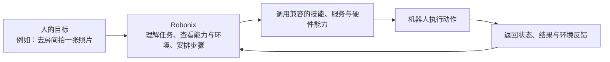
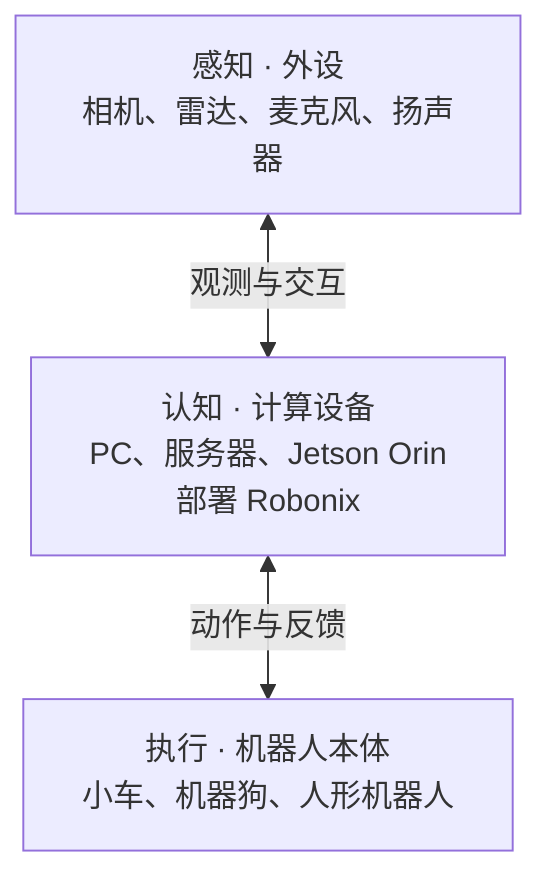

# 认识 Robonix

## 什么是 Robonix

**Robonix 是面向具身智能的开源智能体操作系统。** 它把模型、技能、软件服务和机器人硬件组织成可以发现、组合和复用的能力，让兼容的任务能力能够在不同的机器人形态上复用。

普通的机器人应用往往和某个型号、某套驱动紧紧绑在一起：换一台机器人，就要重新连接硬件、重写功能，再重新调试。Robonix 把这几部分拆开处理：相机、雷达、底盘、机械臂等硬件先提供标准能力；建图、导航、语音等服务调用这些能力；技能把多个能力组合成面向任务的动作；上层模型再根据人的目标选择和安排它们。

对使用者来说，Robonix 更像一个机器人“大脑系统”。你可以用自然语言说出目标，系统结合当前机器人的能力、周围环境和本体状态，生成一组可检查的任务步骤并执行。执行中的计划可以观察、调整或取消；需要确认结果的任务，还可以配置结果验证。任务、技能、服务和硬件之间通过能力约定连接，兼容的能力可以跨机器人复用，但每台机器人仍需满足自己的硬件、软件和配置条件。

Robonix 覆盖从仿真到实体机器人的完整过程：可以先在 Webots、MuJoCo 等仿真环境里熟悉任务流程和开发技能，再把经过验证的能力部署到适配的实体机器人上。它也支持场景理解、建图、导航、自然语言交互和可复用技能的组合。

项目定位、应用场景和系统架构见 [Robonix 官网](https://robonix.ai/)，源码、快速上手和设计说明见 [Robonix GitHub 仓库](https://github.com/syswonder/robonix)。

<figure className="home-architecture-figure">
  
  <figcaption>先只看这条主线：用户提出任务，Robonix 理解并规划，执行器调用服务和硬件能力，机器人返回状态与结果。图中的系统组件会在“原理与参考”中逐一介绍。</figcaption>
</figure>

## Robonix 如何把任务变成动作

你可以把一次任务理解为一条从“想做什么”到“机器人做了什么”的链路：

- **先理解目标。** 你提供的是任务目标，而不是某个厂商 SDK 的调用顺序。
- **再查看条件。** Robonix 会根据当前已注册的能力、机器人本体状态和环境信息组织任务。
- **最后执行并反馈。** 任务步骤会进入执行器，运行状态和结果可以在 Client 或命令行中查看。

因此，Robonix 既可以承接自然语言任务，也可以承接传统控制程序和可复用技能。具体的组件职责、通信方式和接口定义见[原理与参考](architecture/components.md)。

## 感知、认知与执行

下面的“感知—认知—执行”是本手册帮助第一次读者理解设备分工的一种看法，不是 Robonix 的正式组件名称，也不要求准备三台设备。记住一句话就够了：**感知设备收集信息，运行 Robonix 的计算设备理解和安排任务，机器人本体把任务变成动作。**

- **感知：相机、雷达、麦克风等外设。** 相机提供画面，雷达测量周围空间，麦克风接收声音；扬声器负责把机器人的反馈传达给人。这些设备是机器人观察环境和与人交互的入口。
- **认知：运行 Robonix 的计算设备。** PC、服务器、Jetson Orin 等设备承载 Robonix，负责理解任务、发现能力、结合环境和本体状态安排执行步骤。计算设备可以装在机器人上，也可以通过网络与机器人连接。
- **执行：完成动作的机器人本体。** 小车、机器狗、人形机器人、机械臂等本体，通过已经适配的底盘、关节和末端执行器移动、观察和操作。

以一台带相机和雷达的小车为例：相机和雷达负责观察，车上的 PC、服务器或 Orin 运行 Robonix，底盘和电机负责移动。三部分可以装在同一台机器人上；也可以让独立的 PC 或服务器运行 Robonix，通过网络连接远处的传感器和机器人本体。

本手册中的 [Orin 与 x86 分布式部署](getting-started/jetson-x86-webots/README.md)就是后一种部署示例，它说明计算设备和仿真环境如何分开协作，并不是每个使用者都必须采用的配置。平台条件见[项目的平台说明](https://github.com/syswonder/robonix#host-platforms)，具体机器人型号、依赖和已验证能力以 [Hub 机器人目录](https://hub.robonix.ai/discover)中的条目为准。

## 选择你的使用路线

### 没有实体机器人：从仿真开始

先跟随[运行 TIAGo 仿真](getting-started/simulation.md)，在电脑中启动一台虚拟机器人，连接 Client，完成一次相机任务。仿真不需要实体机器人，适合第一次了解 Robonix、验证配置和开发功能。

跑通后，可以沿[软件包开发指南](developer-guide.md)添加原语、服务或技能，在仿真中验证自己的功能。要接入厂商提供的仿真本体，进入 [MuJoCo 仿真本体接入](integration-guide/mujoco-simulation-onboarding.md)。

### 已有实体机器人：先确认是否支持

先打开 [Hub 机器人目录](https://hub.robonix.ai/discover)，搜索自己的型号，核对条目说明、使用的软件包、README、硬件、依赖和运行环境，再选择下一步：

- **已有适用的整机配置**：进入[安装并连接机器人](integration-guide/index.md)，依次完成安装、配置、构建启动和客户端连接。
- **尚未找到适用配置**：进入[开发适配](development/robot-support.md)，接入硬件能力、组织整机配置并验证运行。

  <a className="home-route-card" href="getting-started/simulation">
    
    没有实体机器人
    先运行 TIAGo 仿真，再在仿真中完成任务、开发功能或接入新的仿真本体。
  </a>
  <a className="home-route-card" href="integration-guide">
    
    已有实体机器人
    先在 Hub 查型号和依赖；有可用配置就安装连接，没有就进入开发适配。
  </a>

## 一条主线读完整本手册

1. **先认识 Robonix。** 了解模型、能力、计算设备和机器人本体各自负责什么。
2. **选择起点。** 没有实体机器人就运行仿真；已有机器人就先到 [Hub 目录](https://hub.robonix.ai/discover)确认支持情况。
3. **完成一次任务。** 按对应路线安装配置，连接 Client，先做一次简单的观察或对话任务。
4. **继续使用或开始开发。** 使用建图、导航和场景功能，或者进入[开发与扩展](development/index.md)编写软件包、适配机器人。
5. **遇到问题再查参考。** 日常管理看 Hub 指南，系统边界和接口细节看[原理与参考](architecture/index.md)，异常处理看[附录与维护](appendix/index.md)。

## 手册还包含什么

| 你要做什么 | 阅读内容 |
|---|---|
| 没有实体机器人，先完成一遍使用流程 | [运行 TIAGo 仿真](getting-started/simulation.md) |
| 与机器人对话、下达任务，或进行建图与导航 | [Client 使用指南](getting-started/client.md)、[机器人任务](tasks/index.md) |
| 切换部署、查看历史、备份分享或更新 | [日常管理](hub/index.md) |
| 排查问题、查阅术语 | [问题排查](troubleshooting/index.md)、[常用概念](concepts/glossary.md) |
| 开发软件包、适配本体、配置多平台部署 | [开发与进阶适配](development/index.md) |
| 理解系统组件，查找接口与 API | [工作原理](architecture/components.md)、[接口目录](interface-catalog/index.md)、[参考资料](reference/index.md) |
| 管理账户、反馈、目录同步和服务设置 | [管理后台（管理员）](appendix/admin-console.md) |

Hub、Console 与 Client 分别做什么

| 工具 | 用途 | 在哪里使用 |
|---|---|---|
| [Hub](https://hub.robonix.ai/discover) | 查找机器人与功能，也存放你的配置备份 | 云端网站 |
| [Console](hub/index.md) | 管理机器人的工作台：改配置、启动、看日志 | 安装在机器人主机上，用浏览器打开 |
| [Client](getting-started/first-task.md) | 与机器人的对话窗口：发任务、看进度 | 操作者电脑，可与机器人共用一台 |

Console 的配置助手用来检查和修改配置；让机器人拍照、执行任务，则使用 Client。

