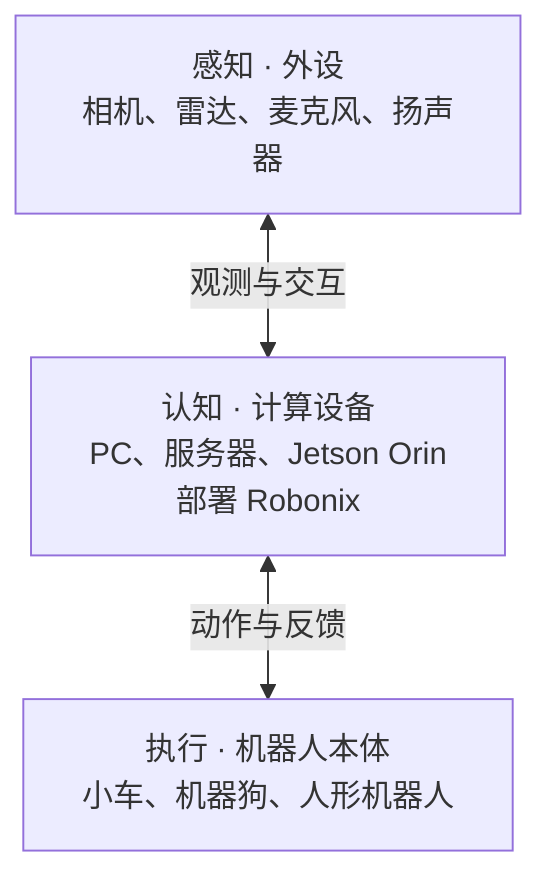

# 认识 Robonix

## 什么是 Robonix

**Robonix 是面向具身智能的开源智能体操作系统。** 它把 AI 模型、机器人技能、软件服务和硬件能力组织在一起，让机器人理解人的任务，并调用自己具备的能力去完成任务。

你用自然语言说明目标，Robonix 结合机器人的能力、周围环境和身体状态，通过大语言模型与视觉语言模型生成任务程序。这个程序可以检查，运行过程可以查看，也可以取消任务；对于指定的任务结果，还可以配置验证。

Robonix 也让机器人软件更容易复用。相机、底盘、机械臂等硬件通过统一接口提供能力，建图、导航和技能在这些接口之上组合。硬件适配与上层功能开发由此分开，兼容的能力可以在不同机器人之间复用。你既可以使用已有功能，也可以在仿真中开发技能，再适配到实体机器人。

项目介绍与完整设计见 [Robonix 官网](https://robonix.ai/)和[源码仓库](https://github.com/syswonder/robonix)。

## 感知、认知与执行

从硬件看，可以按“感知—认知—执行”三个层次，认识 Robonix 连接的外设、计算设备和机器人本体：

- **感知：与环境交互的外设。** 相机提供画面，雷达测量周围空间，麦克风接收声音，扬声器播放声音。
- **认知：部署 Robonix 的计算设备。** PC、服务器或 Jetson Orin 等设备运行 Robonix，结合模型理解任务、组织机器人能力。
- **执行：完成动作的机器人本体。** 小车、机器狗、人形机器人等，通过已适配的底盘、关节或机械臂完成移动与操作。

这三层描述硬件的不同角色，不要求分成三台独立设备。计算设备可以在机器人上，也可以通过网络连接；部署示例见 [Orin 与 x86 分布式部署](getting-started/jetson-x86-webots/README.md)。具体运行环境见[项目的平台说明](https://github.com/syswonder/robonix#host-platforms)，机器人型号和依赖以 [Hub 机器人目录](https://hub.robonix.ai/discover/robot)为准。

## 选择你的使用路线

### 没有实体机器人：从仿真开始

先跟随[运行 TIAGo 仿真](getting-started/simulation.md)，在电脑中启动机器人、连接客户端，完成一次相机任务。

跑通后，可以沿[软件包开发指南](developer-guide.md)添加原语、服务或技能，在仿真中验证自己的功能。需要接入新的仿真本体时，进入 [MuJoCo 仿真本体接入](integration-guide/mujoco-simulation-onboarding.md)。

### 已有实体机器人：先确认是否支持

在 [Hub 机器人目录](https://hub.robonix.ai/discover/robot)查找型号，核对条目说明和 README 中的硬件、依赖与运行环境，再选择下一步：

- **已有适用的整机配置**：进入[安装并连接机器人](integration-guide/index.md)，依次完成安装、配置、构建启动和客户端连接。
- **你的机器人尚未适配**：进入[开发适配](development/robot-support.md)，接入硬件能力、组织整机配置并验证运行。

## 手册还包含什么

| 你要做什么 | 阅读内容 |
|---|---|
| 先熟悉配置界面 | [在线体验](getting-started/online-demo.md) |
| 与机器人对话、下达任务，或进行建图与导航 | [Client 使用指南](getting-started/client.md)、[机器人任务](tasks/index.md) |
| 切换部署、查看历史、备份分享或更新 | [日常管理](hub/index.md) |
| 排查问题、查阅术语 | [问题排查](troubleshooting/index.md)、[常用概念](concepts/glossary.md) |
| 开发软件包、适配本体、配置多平台部署 | [开发与进阶适配](development/index.md) |
| 理解系统组件，查找接口与 API | [工作原理](architecture/components.md)、[接口目录](interface-catalog/index.md)、[自动生成的参考](reference/index.md) |

手册中用到的 Hub、Console 与 Client

| 工具 | 用途 | 在哪里使用 |
|---|---|---|
| [Hub](https://hub.robonix.ai/discover) | 查找机器人与功能，也存放你的配置备份 | 云端网站 |
| [Console](hub/index.md) | 管理机器人的工作台：改配置、启动、看日志 | 安装在机器人主机上，用浏览器打开 |
| [Client](getting-started/first-task.md) | 与机器人的对话窗口：发任务、看进度 | 操作者电脑，可与机器人共用一台 |

Console 的配置助手用来改参数；让机器人拍照、执行任务，则使用 Client。

界面名称与版本

部分截图中的名称与当前界面不同，可按下表找到对应入口：

| 截图中的名称 | 当前界面名称 |
|---|---|
| 本机 Robonix Hub | Robonix Console |
| 云端 Robonix Hub Cloud | Robonix Hub |
| 部署 / 版本 | 配置 / 历史 |
| 本机环境变量 / 云端副本 | 机器人环境变量 / 云端备份 |
| 安装到本机 / 添加到本机 | 安装到这台机器人 / 添加到这台机器人 |

名称和 Hub 链接按 2026-10-14 的公开页面核对。后续新增功能以对应版本的[更新日志](https://hub.robonix.ai/changelog)为准。

开发示例对应 Robonix 源码 [`223675d9`](https://github.com/syswonder/robonix/tree/223675d9a5000e70debae4f2512404cec5c9c442)，由 `ROBONIX_SOURCE_REVISION` 记录。Client 安装示例对应源码 `739f8499`；独立建图、导航等软件包的版本见各自指南。

安装 Hub 整机条目时，仍需核对该条目版本的 README 和依赖。

